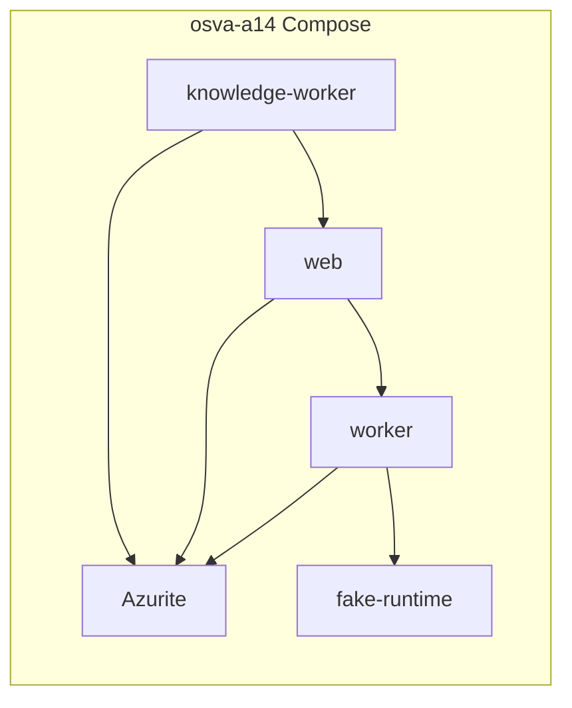

# A1.4 integration design and impact inventory

**Status:** Harness implemented; full acceptance **executed** locally (see `scripts/acceptance/a1-4/evidence/latest.json`)
**Baseline:** osva-adapters `main` @ RC3 contracts (`@osva-ai/contracts@1.1.0-rc.3`, no pnpm patch)
**OSVA core:** `v1.1.0-rc.3` (`744c1bbd8f968bc8c0293de5372fb9e59964286c`)

## Impact inventory

| Area                                         | Change                                                |
| -------------------------------------------- | ----------------------------------------------------- |
| `scripts/acceptance/a1-4/`                   | New Docker Compose acceptance harness, runner, probes |
| `docs/acceptance/A1_4_INTEGRATION_DESIGN.md` | This document                                         |
| `scripts/acceptance/a1-4/README.md`          | Operator deployment notes                             |
| `ENGINEERING_VERIFICATION_PLAYBOOK.md`       | `verify:a1-4` gate                                    |
| `docs/roadmap/IMPLEMENTATION_TRACKER.md`     | A1.4 row + verification checklist                     |
| `COMPATIBILITY.md` / root `README.md`        | A1.4 pointer                                          |
| OSVA core                                    | **No changes** (by design)                            |

Out of scope: npm publish of adapter, GHCR publication of RC3, live Azure subscription tests.

## Documented vs proven behavior

| Behavior                                        | Documented (OSVA / adapters)                         | Proven by A1.4 execution                            |
| ----------------------------------------------- | ---------------------------------------------------- | --------------------------------------------------- |
| `registered` driver env vars                    | Adapter README, OSVA `loadArtifactStorageConfig`     | Compose env + process startup                       |
| Dynamic `import(registerModule)`                | `adapters/artifact-storage/src/registered-loader.ts` | `probe-module-resolution.mjs` from each process cwd |
| Web/worker/knowledge-worker resolve on start    | M12.4.4 closeout summary                             | Healthy containers + cross-process HTTP             |
| Azure adapter factory reads env at factory time | `@osva-ai/adapter-artifact-azure` README             | Azurite-backed writes                               |
| Fail closed on bad module/config                | OSVA registered-loader + adapter config              | Negative `docker compose run` cases                 |
| Official RC3 OCI image                          | Release docs (RC2 inventory; RC3 tag on GitHub)      | **Attempt** GHCR `1.1.0-rc.3`; fallback git build   |

## Module resolution path

OSVA loads storage from `@osva/adapters-artifact-storage`:

1. `loadArtifactStorageConfig()` reads `OSVA_ARTIFACT_STORAGE_DRIVER=registered` and `OSVA_ARTIFACT_BLOB_STORE_REGISTER_MODULE`.
2. `loadRegisteredArtifactBlobStore()` executes `await import(config.registerModule)`.
3. Node resolves bare specifiers from the **workspace root** `node_modules` tree (`/app` in the official image).

A1.4 installs the packed adapter by **unpacking the tarball** into `/app/node_modules/@osva-ai/adapter-artifact-azure` and running `npm install --omit=dev` in that directory (see `Dockerfile.osva-with-azure-adapter`). This avoids mutating the pnpm workspace root after `pnpm prune --prod`.

Module probes run from `/app/adapters/artifact-storage/dist/` because Node resolves bare specifiers from the **importer’s path**, matching `registered-loader.js` behavior.

## Deployment architecture

- **Image provenance:** derived `osva-a14-with-azure:local` ← RC3 OSVA base ← git tag `v1.1.0-rc.3` or GHCR when available.
- **Shared backend:** single Azurite blob service; no filesystem artifact volume.
- **Isolation:** Compose project name `osva-a14`, ports `18080` / `11000`.

## Acceptance mapping (M12.4.3 / M12.4.4)

| OSVA slice                                 | A1.4 evidence                                         |
| ------------------------------------------ | ----------------------------------------------------- |
| M12.4.3 registered loader + contracts port | Module probe + npm pack install                       |
| M12.4.4 web + knowledge-worker resolve     | Running processes + ingestion path                    |
| M12.4.4 worker → web artifact              | Remote HTTP run + content GET                         |
| External packaged adapter                  | `pnpm pack` + Dockerfile install (not workspace link) |

## Deferred verification

- Live Azure Storage (non-Azurite) in CI or customer VPC
- GHCR `ghcr.io/osva-ai/osva:1.1.0-rc.3` when manifest is published (harness auto-detects)
- Full OSVA core CI matrix locally

## Security review (harness)

- No credentials committed; `.env` gitignored; example uses public Azurite dev key
- No runtime adapter download; image build installs tarball explicitly
- Negative tests confirm fail-closed startup
- Log scan for `AccountKey=` / devstore key fragment after happy path
